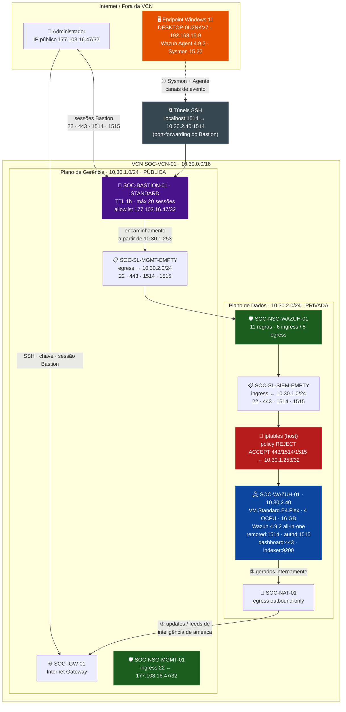
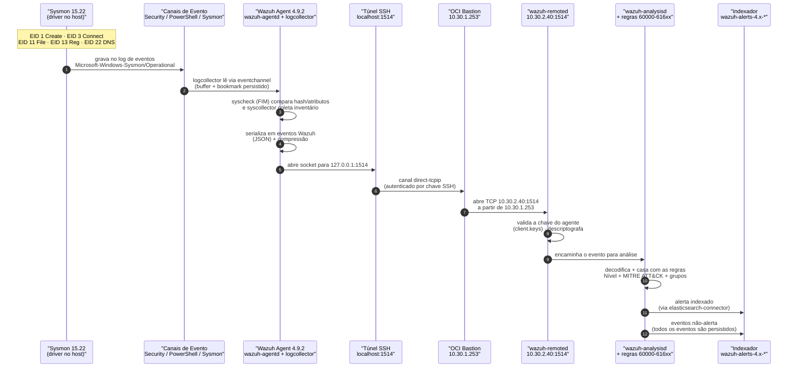

# Architecture — SOC Autonomous Lab

> **Deep-dive de arquitetura** do laboratório SOC autônomo construído sobre a VCN OCI
> `SOC-VCN-01`. Documento de portfólio — descreve a arquitetura **como construída**, com as
> decisões, camadas de controle e caminhos de dados validados em produção.

| | |
|---|---|
| **Tenancy compartment** | `ocid1.tenancy.oc1..aaaaaaaazux2rh4z6kzy7n3dasqvxh3amxi7h4weinrhqpfrawb5e7bv4jbq` |
| **Região / AD** | `sa-saopaulo-1` / `YvZu:SA-SAOPAULO-1-AD-1` |
| **VCN** | `SOC-VCN-01` — `10.30.0.0/16` |
| **IP privado do manager** | `10.30.2.40` — **atribuído pela OCI e não estável**: muda a cada recreate da VM (ver §2.4) |
| **Stack de segurança** | Wazuh 4.9.2 (manager + indexer + dashboard) · Wazuh Agent 4.9.2 · Sysmon 15.22 (SwiftOnSecurity) |
| **Modelo de acesso** | Zero Trust — OCI Bastion (STANDARD) como único caminho de ingress |
| **Documentos relacionados** | [`phase2_design.md`](phase2_design.md) · [`adr-001-persistent-agent-connectivity.md`](adr-001-persistent-agent-connectivity.md) · [`final_review.md`](final_review.md) |

---

## 1. Logical Architecture

A arquitetura separa rigorosamente **dois planos** com requisitos,Superfícies e ciclos de vida
distintos. Essa separação é o eixo central do design — e é o que permite que a camada de
administração seja destruída e recriada sem jamais expor o plano de dados.

### 1.1 Plano de Gerência (Management Plane)

Responsável por **como um operador alcança a infraestrutura**. Nunca transporta telemetria de
produção.

| Componente | Identidade | Função |
|---|---|---|
| **OCI Bastion** `SOC-BASTION-01` | STANDARD, `max-session-ttl-in-seconds = 3600`, `max-sessions-allowed = 20`, `client-cidr-block-allow-list = 177.103.16.47/32` | Único ponto de ingress. Sessões *port-forwarding* autenticadas por chave SSH, com TTL de 1 h |
| **Sub-rede MGMT** `SOC-SUBNET-MGMT-01` (`10.30.1.0/24`) | pública, `prohibit_public_ip_on_vnic = false` | Hospeda o endpoint privado do Bastion (`10.30.1.253`) |
| **NSG MGMT** `SOC-NSG-MGMT-01` | — | Ingress TCP/22 **apenas** do `/32` de administrador aprovado |
| **Security List MGMT** `SOC-SL-MGMT-EMPTY` | — | Egress para `10.30.2.0/24` nas portas 22, 443, 1514, 1515 |
| **Internet Gateway** `SOC-IGW-01` | — | Saída pública da sub-rede MGMT |

**Propriedades estruturais do plano de gerência:**

- **Não há VM de administração.** A sub-rede MGMT existe **apenas** para o endpoint privado do
  serviço Bastion. O acesso do administrador é direto ao Bastion, sem host intermediário.
- **Allowlist de `/32`.** O Bastion só aceita conexões de origem `177.103.16.47/32`. Um
  administrador em outra rede é rejeitado **antes** de qualquer autenticação.
- **Nenhuma porta de serviço exposta.** 22/443/1514/1515 **saem** da sub-rede MGMT apenas
  endereçados a `10.30.2.0/24` — nunca a `0.0.0.0/0`.
- **Ciclo de vida independente.** Destruir o plano de gerência não afeta o plano de dados.

### 1.2 Plano de Dados (Data Plane / SIEM)

Responsável por **receber, correlacionar, persistir e servir** a telemetria de segurança.
Alcançável **somente** a partir do plano de gerência.

| Componente | Identidade | Função |
|---|---|---|
| **VM Wazuh all-in-one** `SOC-WAZUH-01` | `VM.Standard.E4.Flex`, 4 OCPU, 16 GB, boot volume 120 GB Balanced | Manager + Indexer + Dashboard |
| **Sub-rede SIEM** `SOC-SUBNET-SIEM-01` (`10.30.2.0/24`) | privada, `prohibit_public_ip_on_vnic = true` | Isola a workload de dados |
| **NSG WAZUH** `SOC-NSG-WAZUH-01` | 11 regras (6 ingress + 5 egress) | Filtro mais estreito, aplicado ao VNIC |
| **Security List SIEM** `SOC-SL-SIEM-EMPTY` | ingress de `10.30.1.0/24`; egress de retorno | Filtro de sub-rede |
| **NAT Gateway** `SOC-NAT-01` | — | Egress **somente de saída** via rota default `0.0.0.0/0` → NAT |

**Serviços no plano de dados:**

| Porta | Serviço | Exposição |
|---|---|---|
| `1514` | `wazuh-remoted` — recepção de eventos | Ingress **apenas** de `10.30.1.0/24` |
| `1515` | `wazuh-authd` — registro/enrollment | Ingress **apenas** de `10.30.1.0/24` |
| `443` | Dashboard (Node.js) | Ingress **apenas** de `10.30.1.0/24` |
| `9200` | Indexer (OpenSearch) | **Ausente** de toda regra de ingress |
| `55000` | API do Wazuh | **Ausente** de toda regra de ingress |
| `22` | SSH administrativo | Ingress **apenas** de `10.30.1.0/24` |

**Propriedades estruturais do plano de dados:**

- **Zero superfície pública.** A VM não tem IP público e a sub-rede **proíbe** a atribuição de um
  (`prohibit_public_ip_on_vnic = true`) — uma segunda barreira, independente das regras, contra
  exposição acidental.
- **Ingress unidirecional de gerência.** O plano de dados **aceita** de `10.30.1.0/24` e
  **origina** apenas tráfego de retorno para o mesmo prefixo (via NAT para o resto da internet).
- **Firewall de host como terceira camada.** `iptables` no próprio host, política `REJECT` com
  `ACCEPT` explícito apenas para `22`, `443`, `1514`, `1515` a partir de `10.30.1.253/32`.

### 1.3 Por que a separação importa

| Questão | Com plano único | Com planos separados |
|---|---|---|
| O plano de gerência pode ser destruído? | Não — derruba a coleta | **Sim** — sem afetar a coleta |
| A workload recebe tráfego da internet? | Quando o plano está exposto | **Nunca** — sub-rede privada, sem IP público |
| Qual é a superfície de um comprometimento da VM? | Alcança a saída pública | Limitada à sub-rede SIEM |
| É possível auditar o acesso administrativo? | Misturado com o tráfego de dados | **Sim** — bastion-hours e session-hours são轮廓 próprios |
| Um plano pode ter ciclo de vida / custo próprio? | Não | **Sim** — governança e FinOps separados |

---

## 2. Network Topology

### 2.1 Topologia lógica (Mermaid)



### 2.2 Topologia física — regras de cada camada

| Camada | Recurso | Regras | Efeito |
|---|---|---|---|
| **VCN** | `SOC-DEFAULT-SL-DENY-ALL` | gerenciada e **esvaziada** | Remove a regra SSH padrão da OCI, que exporia 22 de `0.0.0.0/0` |
| **Sub-rede MGMT** | `SOC-SL-MGMT-EMPTY` | egress → `10.30.2.0/24` : 22, 443, 1514, 1515 | Único destino do plano de gerência |
| **Sub-rede SIEM** | `SOC-SL-SIEM-EMPTY` | ingress ← `10.30.1.0/24` : 22, 443, 1514, 1515 · egress → `10.30.1.0/24` : 443, 1514, 1515 | Origem e destino do caminho do Bastion |
| **NSG MGMT** | `SOC-NSG-MGMT-01` | ingress 22 ← `177.103.16.47/32` · egress DNS/NTP/HTTP(S) | Filtro estreito no VNIC de administração |
| **NSG WAZUH** | `SOC-NSG-WAZUH-01` | ingress 22, 443, 1514, 1515 ← `10.30.1.0/24` · ingress 1514, 1515 ← `10.30.2.0/24` · egress 80/443/53/123 | Filtro no VNIC da workload |
| **Host** | `iptables` | `REJECT` default · `ACCEPT` 22 · `ACCEPT` 443/1514/1515 ← `10.30.1.253/32` | Terceira camada, defense-in-depth |

> ### ⚠️ A regra que mais custou tempo nesta implantação
>
> **NSGs e Security Lists são aplicados de formaconjuntiva (AND).** O tráfego precisa ser
> permitido por **ambos** — e uma security list **sem regras nega tudo** para a sub-rede.
>
> O design original declarava as duas security lists como vazias com a premissa de que
> *"as permissões são centralizadas nos NSGs"*. Essa premissa é **falsa no OCI**: com as listas
> vazias, o Bastion **nunca** alcançava o manager — o bloqueio ocorria na camada VCN, **acima**
> do firewall do host, e portanto **nenhum log de iptables aparecia** para diagnóstico.
>
> A correção está codificada em `infrastructure/terraform/main.tf` (ver §3.4).

### 2.3 Caminhos de rede (tabela de alcançabilidade)

| Origem | Destino | Porta | Caminho | Permitido |
|---|---|---|---|---|
| `177.103.16.47/32` | Bastion | 22 | Internet → IGW | ✅ |
| Bastion `10.30.1.253` | Manager `10.30.2.40` | 22 | SL MGMT → NSG WAZUH → SL SIEM → iptables | ✅ |
| Bastion `10.30.1.253` | Manager `10.30.2.40` | 443 | idem | ✅ |
| Bastion `10.30.1.253` | Manager `10.30.2.40` | 1514 | idem | ✅ |
| Bastion `10.30.1.253` | Manager `10.30.2.40` | 1515 | idem | ✅ |
| Manager `10.30.2.40` | Indexer `9200` / API `55000` | — | local (loopback) | ✅ interno |
| Manager `10.30.2.40` | Internet | 80/443/53/123 | NAT → IGW | ✅ egress |
| Qualquer origem | Manager | 9200 / 55000 | — | ❌ **ausente de toda regra** |
| Internet | Manager | qualquer | sem IP público | ❌ |
| `10.30.2.0/24` (SIEM) | Manager | 1514 / 1515 | intra-sub-rede | ✅ agentes privados futuros |

---

## 2.4 O IP privado é um dado de runtime, não uma constante

Um detalhe de operação que tem impacto arquitetural direto: **o IP privado da VM é atribuído
pela OCI e muda a cada recreate da infraestrutura.**

| Recurso | Antes do recreate | Depois |
|---|---|---|
| IP privado da VM | `10.30.2.49` | **`10.30.2.40`** |
| OCID da instância | `…antxeljr6brcn3qchqjyx64pet2rbj2qqcbi7tdbvnyiurbhnra2oyhfzsfq` | `…antxeljr6brcn3qcumhbt4gacdbv4vwfm37gwal3teru7islt6mendqaymxq` |
| OCID da sub-rede SIEM | `…aaaaaaaa4y44kpa5ikwjyd6a43wpz22x6mk2jrn6l5mxpvwmj2tzne7rs5ha` | `…aaaaaaaa3lnd3adatnzsrfunpje7ehfjyxah7hc5ja3sd35evkydixk7jdyq` |
| OCID do NSG do Wazuh | `…aaaaaaaak36lbcxeixrbmfswxg26czzgvbeqxfdkg7uv6eidrd2t6oyxp6qq` | `…aaaaaaa4pd5w67ris4l6mnohvos7lqofgcxjleevziwr6ohwnbicgh25l2q` |

**Impacto na arquitetura.** O agente Windows não conhece o IP do manager — ele aponta para
`127.0.0.1` (§4.3). O IP do manager aparece **apenas na fronteira**: nas *target-resource-details*
das sessões do Bastion. Portanto, uma mudança de IP **não** quebra o `ossec.conf`, mas **invalida
as sessões do Bastion em uso** — e o sintoma é silencioso (o SSH autentica, o forward morre).

**Regra de projeto derivada.** Endereços de infraestrutura nunca são constantes em runbook,
`.tfvars` ou sessão do Bastion. A única fonte de verdade é:

```powershell
$ip = (terraform output -raw wazuh_private_ip).Trim()
```

**Correção estrutural recomendada.** A sub-rede SIEM já declara `dns_label = "siem"`, o que
disponibiliza o nome `soc-wazuh-01.siem.soclab.oraclevcn.com`. Usá-lo nas sessões do Bastion
eliminaria **inteiramente** essa classe de falha e tornaria o lab **auto-healing** frente a
recreates.

---

## 3. Security & Identity (Zero Trust)

### 3.1 Como o OCI Bastion funciona

O Bastion **não é** um servidor SSH. É um **orquestrador de sessões de curta duração**, e essa
distinção é a chave para entender toda a arquitetura:

1. O administrador abre uma sessão `PORT_FORWARDING` no Bastion, vinculada a uma **sub-rede alvo**
   e a uma **porta alvo** dentro dela.
2. O OCI materializa um host efêmero na **sub-rede de gerenciamento** do Bastion
   (`10.30.1.253` neste lab), autorizado pela `client-cidr-block-allow-list`.
3. O administrador conecta via SSH **usando o OCID da sessão como usuário**:
   ```
   ssh -i <chave> -N -L 127.0.0.1:1514:10.30.2.40:1514 -p 22 \
       ocid1.bastionsession.oc1...@host.bastion.sa-saopaulo-1.oci.oraclecloud.com
   ```
4. O canal `direct-tcpip` do SSH é aberto pelo host efêmero **de dentro da VCN** — o Bastion
   funciona como um relay autenticado, sem ever expor a workload.
5. **Ao expirar o TTL, a sessão e a conexão SSH são encerradas.** Não há como torná-la persistente.

**Consequências de segurança diretas:**

- O serviço **não** é um alvo de SSH aberto — cada sessão é autenticada por chave e vinculada a
  um OCID específico.
- A superfície de ataque é a **chave SSH**, não a senha.
- O allowlist de `/32` no serviço é a **primeira** barreira, antes mesmo da autenticação.
- **Não existe** caminho do plano de dados que não passe por uma sessão autenticada.

### 3.2 Perfis IAM de menor privilégio

A separação entre *descoberta*, *aplicação* e *operação* é materializada em **perfis OCI
distintos** com credenciais separadas:

| Perfil | Finalidade | Privilégio | Usado para |
|---|---|---|---|
| `SOC_DISCOVERY` | Descoberta de recursos e `terraform plan` | **Somente leitura** | `terraform plan`, inventário, `oci ... list/get` |
| `SOC_TERRAFORM` | Aplicação de mudanças de infraestrutura | Escrita **restrita** aos recursos do VCN | `terraform apply` |
| `DEFAULT` | Administração e troubleshooting | **Administrador completo** | только电路 debugging, `oci bastion session create`, leitura de logs |

**Regras de higiene aplicadas:**

- `providers.tf` define `config_file_profile = var.oci_profile`, com **default `SOC_DISCOVERY`** —
  um `terraform plan` com as credenciais padrão do projeto **não pode alterar nada**.
- O `terraform.tfvars` local (ignorado pelo Git) é o único lugar onde o perfil é sobrescrito para
  `apply`, e ele é **excluído do versionamento** (`.gitignore`: `terraform.tfvars`).
- O perfil administrativo **nunca** é materializado no Terraform.
- Chaves privadas (`*.pem`, `*.key`) e `Senha Wazuh.txt` estão **ignorados** pelo Git e
  lives apenas em `Desktop\sshkeys\`.

> **Nota de governança (achado de auditoria):** no ciclo de implementação deste lab, o `apply`
> foi executado com o perfil `DEFAULT` (administrador) porque o perfil de menor privilégio não
> possuía permissão de escrita comprovada no compartment da tenancy. **A lacuna a corrigir** é
> provisionar `SOC_TERRAFORM` com uma policy de escrita restrita a
> `oci_core_*`, `oci_network_*` no VCN `SOC-VCN-01` — e então remover a necessidade do perfil
> administrativo.

### 3.3 Identidade do endpoint

| Atributo | Valor | Papel |
|---|---|---|
| Agent ID | `002` | Identificador estável no manager |
| Agent name | `DESKTOP-0U2NKV7` | Legível |
| IP registrado | `any` | **Sem pin de IP** — a identidade é a **chave**, não o endereço |
| Chave | pré-compartilhada, emitida pelo `authd` no registro | Identidade criptográfica do agente |
| Registro | `wazuh-authd` (1515), `use_password = no` | Re-enrollment automático quando o manager rejeita a chave |
| Transporte | TLS + AES | `crypto_method = aes` |

> **Nota de registro.** O agente re-registra **sozinho** quando o manager rejeita sua chave: o
> `wazuh-agentd` tenta o `authd` automaticamente e assume o nome do **hostname** como
> `agent name`. Foi assim que o lab se auto-restaurou após o recreate (§2.4) — sem intervenção.
> Para fixar um nome estável (`windows-endpoint`), use `agent-auth.exe -u windows-endpoint`
> explicitamente e remova o registro antigo com `manage_agents -r <id>`.
>
> ⚠️ **Risco operacional:** com `use_password = no` no `authd`, **qualquer** agente que alcance a
> porta 1515 consegue se registrar. A exposição fica contida pelo allowlist do Bastion
> (`177.103.16.47/32`) e pela regra de ingress `10.30.1.0/24`, mas em produção o `authd` deveria
> exigir senha (`use_password = yes`) e a porta 1515 deveria ser **fechada após o registro**.


### 3.4 Camadas de filtragem — modelo de aplicação

```
   Pacote para 10.30.2.40:1514 (origem: Bastion 10.30.1.253)
        │
        ▼
 ┌─────────────────────────────────────────────────────────┐
 │ CAMADA 1 — NSG do VNIC (SOC-NSG-WAZUH-01)              │
 │   ✗ausente → descartado silenciosamente                │
 └─────────────────────────────────────────────────────────┘
        │ ✓
        ▼
 ┌─────────────────────────────────────────────────────────┐
 │ CAMADA 2 — Security List da sub-rede (SOC-SL-SIEM-EMPTY)│
 │   ✗ ausente → descartado silenciosamente                │
 │   ⚠️ lista vazia = NEGA TUDO para a sub-rede            │
 └─────────────────────────────────────────────────────────┘
        │ ✓
        ▼
 ┌─────────────────────────────────────────────────────────┐
 │ CAMADA 3 — iptables do host (INPUT, policy REJECT)      │
 │   ✗ausente → REJECT + ICMP administratively-prohibited │
 │   ✓ SEM LOG quando bloqueado nas camadas 1–2           │
 └─────────────────────────────────────────────────────────┘
        │ ✓
        ▼
   wazuh-remoted :1514  →  decodificação de regras  →  alertas
```

**Por que a ordem importa para o diagnóstico:** um bloqueio nas camadas 1 ou 2 é **invisível** no
host — não há contador de iptables, não há log. Somente a camada 3 gera rastro local. Por isso o
procedimento de diagnóstico correto é **de cima para baixo**: confirmar as regras OCI via
`oci network nsg rules list` / `oci network security-list get` **antes** de investigar o host.

### 3.5 Controles complementares

| Controle | Implementação |
|---|---|
| Menos privilégio no host | Admin via `ubuntu` + `sudo`; agente roda como `LocalSystem` (serviço) |
| Imutabilidade de config | `ossec.conf` e `client.keys` com ACL explícita negando leitura a `Authenticated Users` — exigem elevação para editar |
| Baseline de criptografia | `wpk_root.pem` para validação do certificado do manager |
| Auditoria de logging | `ossec.log` local do agente + `alerts.log`/`alerts.json` no manager |
| Integridade de configuração | `terraform plan` como verificação de drift; **`No changes`** é o gate antes de qualquer mudança |
| Rastreabilidade | Toda mudança de infraestrutura no Terraform, com `serial` de state versionado (`46`) |

---

## 4. Data Flow — Telemetria do Endpoint ao Índice

### 4.1 Visão geral (Mermaid)



### 4.2 Etapas em detalhe

#### Etapa 1 — Coleta no endpoint

| Fonte | Mecanismo | Eventos |
|---|---|---|
| **Sysmon 15.22** | Driver `SysmonDrv` + serviço `Sysmon64`; config SwiftOnSecurity (`sysmonconfig-export.xml`, schema 4.50) | EID 1 (Process Create), EID 3 (Network Connect), EID 7 (Image Load), EID 11 (FileCreate), EID 13 (Registry), EID 22 (DNS) |
| **Canal Security** | `eventchannel` com query de exclusão dos EventIDs ruidosos (4656, 4663, 4670, 4690, 4703, 5156…) | 4624, 4625, 4688, 4738 |
| **Canal PowerShell/Operational** | `eventchannel` + **Script Block Logging** (`ScriptBlockLogging = 1`) | 4104 — texto do script block decodificado |
| **FIM** | `syscheck` com `realtime="yes"` + `check_all="yes"` em `C:\SOC-Lab` | Alterações de hash/tamanho/mtime |

A configuração de coleta do agente (`ossec.conf`) é a fonte de verdade:

```xml
<localfile>
  <location>Microsoft-Windows-Sysmon/Operational</location>
  <log_format>eventchannel</log_format>
</localfile>
<localfile>
  <location>Microsoft-Windows-PowerShell/Operational</location>
  <log_format>eventchannel</log_format>
</localfile>
<syscheck>
  <directories realtime="yes" check_all="yes">C:\SOC-Lab</directories>
</syscheck>
```

#### Etapa 2 — Serialização e criptografia

O `wazuh-agentd` serializa cada evento em JSON, comprime e cifra com AES (`crypto_method = aes`),
usando a chave pré-compartilhada em `client.keys`.

#### Etapa 3 — Transporte (o ponto frágil)

```
wazuh-agentd  ──TCP──▶  127.0.0.1:1514  ──▶  [túnel SSH local]
                                                   │
                                          canal direct-tcpip (autenticado)
                                                   │
                                     Bastion 10.30.1.253 ──TCP──▶ 10.30.2.40:1514
```

O agente **só conhece `127.0.0.1`**. Essa decisão é a origem do acoplamento descrito no
ADR-001: o canal de telemetria é tão durável quanto a sessão do Bastion que o transporta.

#### Etapa 4 — Recepção e autenticação

`wazuh-remoted` valida a chave do agente contra `/var/ossec/etc/client.keys`, descriptografa e
encaminha para `wazuh-analysisd`. Uma chave desconhecida produz a mensagem
`ERROR: Unable to add agent (from manager)` e o agente **não** é registrado.

#### Etapa 5 — Correlação e indexação

`analysisd` decodifica o evento, casa com as regras ativas e atribui **nível**, **grupo** e
**técnica MITRE ATT&CK**. Exemplos reais de regras disparadas:

| Regra | Nível | Grupo | MITRE | Detecção |
|---|---:|---|---|---|
| `60122` | 5 | `authentication_failed` | T1531 | 4625 — falha de logon |
| `60110` | 8 | `account_changed` | T1098 | 4738 — conta criada |
| `91809` | **10** | `windows,powershell` | T1140 | 4104 com `FromBase64String` |
| `92057` | **12** | `sysmon_eid1_detections` | T1059.001 | PowerShell com `-EncodedCommand` |
| `92004` | 4 | `sysmon_eid1_detections` | T1059.003 | PowerShell gerando `cmd.exe` |
| `92037` | 3 | `sysmon_eid1_detections` | T1567 | `net.exe` para recurso remoto |
| `550` | 7 | `syscheck_entry_modified` | T1565.001 | Integridade do arquivo alterada |

A indexação segue pela `elasticsearch-connector` do manager 4.9 para o índice
`wazuh-alerts-4.x-*`, com o `filebeat` como *shipper* de arquivos complementares.

### 4.3 Validação ponta a ponta

A cadeia foi comprovada com 3 simulações controladas em 2026-11-03 (02:01–02:04 UTC), produzindo
**24 alertas** atribuíveis ao ataque em uma janela de ~3 minutos. Detalhe completo em
[`investigations/SOC-001-002-003-Report.md`](../investigations/SOC-001-002-003-Report.md).

---

## 5. Limites Conhecidos e Direção de Evolução

| Limitação | Impacto | Direção |
|---|---|---|
| **TTL de 1 h do Bastion** | O agente fica cego de telemetria a cada hora, **em silêncio** | ADR-001 — proxy TCP persistente (`nginx stream`) ou VPN Site-to-Site |
| **Credencial do agente = chave estática** | Sem rotação nem mTLS por sessão | Rotação periódica via `manage_agents`; Forensic |
| **`1515` permanece exposto após o registro** | Superfíce de enrollment desnecessária | Remover a regra de ingress 1515 após o registro |
| **Regras de iptables fora do IaC** | Recuperação após destroy exige passo manual | Mover para `cloud-init`/`user_data` |
| **Bastion fora do state do Terraform** | `destroy` não o remove; `apply` não o recria | Automatizar via módulo ou `oci bastion` em script |
| **Manager 4.9.2 é EOL** | Sem patches; o agente teve de ser rebaixado para 4.9.2 | Upgrade coordenado manager → indexer → dashboard → agente |
| **Sem detecção de perda de telemetria** | A queda do canal não gera alerta | Regra de "keepalive ausente" para o agente `001` |
| **Estado do Terraform é local** | Perda do state = perda de manageabilidade | Backend remoto (S3 + DynamoDB) com lock |

---

## 6. Referências

| Documento | Escopo |
|---|---|
| [`phase1_discovery.md`](phase1_discovery.md) | Descoberta do estate OCI pré-existente |
| [`phase2_design.md`](phase2_design.md) | Design de rede e segurança (com as correções de Fases 9/10) |
| [`adr-001-persistent-agent-connectivity.md`](adr-001-persistent-agent-connectivity.md) | ADR — transporte persistente além do TTL do Bastion |
| [`final_review.md`](final_review.md) | Arquitetura, FinOps, teardown e recuperação |
| [`../investigations/SOC-001-002-003-Report.md`](../investigations/SOC-001-002-003-Report.md) | Relatório formal de investigação — 3 simulações de ataque |
| `infrastructure/terraform/main.tf` | IaC — VCN, sub-redes, NSGs, security lists, NAT e a VM |
